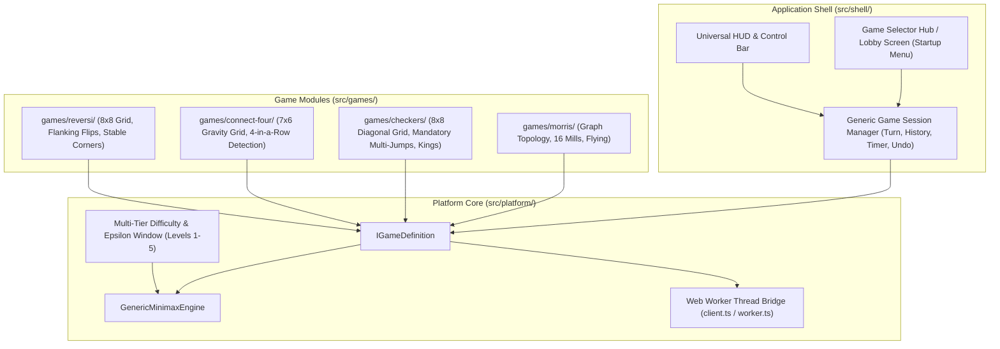

# Classic Board Games (Multi-Game Platform)

[](https://github.com/cdr74/boardgames/actions/workflows/ci.yml)
[](LICENSE)
[](https://github.com/cdr74/boardgames)

A lean, responsive, cross-platform multi-game boardgame suite featuring an on-device deterministic game engine with scalable difficulty levels (Levels 1–5). Playable in modern desktop and mobile browsers, and installable as an Android PWA or native APK via Capacitor.

---

## 🎮 Supported & Planned Games

| Game | Status | Topology | Mechanics | Engine Features |
| :--- | :---: | :--- | :--- | :--- |
| **Nine Men's Morris** (*Mühlespiel*) | 🟢 Ready | 24-point 3-square graph | Placement, sliding, flying, 16 mill lines | Alpha-Beta + Zobrist + Epsilon Pooling |
| **English Checkers** (*Draughts*) | 🟡 In Scaffolding | 8x8 checkerboard (32 dark squares) | Diagonal slides, mandatory jumps, kinging | Alpha-Beta + Forced Jump Priority |
| **Connect Four** | ⚪ Planned | 7x6 vertical gravity grid | Column drop, 4-in-a-row alignment | Alpha-Beta + Alignment Heuristics |
| **Reversi** (*Othello*) | ⚪ Planned | 8x8 grid | Flanking ray captures, disc flips | Alpha-Beta + Corner Stability |

---

## 🏛 Platform Architecture



### Architectural Principles:
1. **Zero Framework Overhead:** Built with pure Vanilla TypeScript and native responsive SVG (`viewBox="0 0 600 600"`). Instant load times, no heavy virtual DOM diffing.
2. **Deterministic On-Device Calculation:** Zero remote API calls. All game logic and Alpha-Beta minimax calculations run strictly on-device inside a local Web Worker thread.
3. **Pluggable Game Definition Contract:** Every game implements `IGameDefinition<TState, TMove>`, allowing identical session lifecycle, undo/redo stacks, difficulty configs, and candidate randomization across all games.
4. **Startup Menu Flow:** The app opens directly to a clean Game Lobby menu allowing instant selection of any game, switching between games at any time, or resuming matches.

---

## 🚀 Quickstart

### Prerequisites
- Node.js $\ge 20.0.0$
- npm $\ge 10.0.0$

### Setup & Local Development
```bash
# Clone the repository
git clone https://github.com/cdr74/boardgames.git
cd boardgames

# Install dependencies
npm install

# Start local dev server (Vite on http://localhost:3000)
npm run dev

# Run unit and engine test suite (Vitest)
npm test

# Type-check and production build (outputs to dist/)
npm run build
```

---

## 📖 Documentation Suite

- [`docs/BACKLOG.md`](docs/BACKLOG.md): Product roadmap, milestone tracking, and active session handoff block.
- [`docs/design/architecture.md`](docs/design/architecture.md): Deep architectural breakdown and component contracts.
- [`docs/adr/`](docs/adr/): Architecture Decision Records.
- [`docs/USER_GUIDE.md`](docs/USER_GUIDE.md): Game rules, mechanics, and player instructions.
- [`GEMINI.md`](GEMINI.md): Native Antigravity project conventions and boundaries.

---

## 📄 License
MIT © Christian Raess
