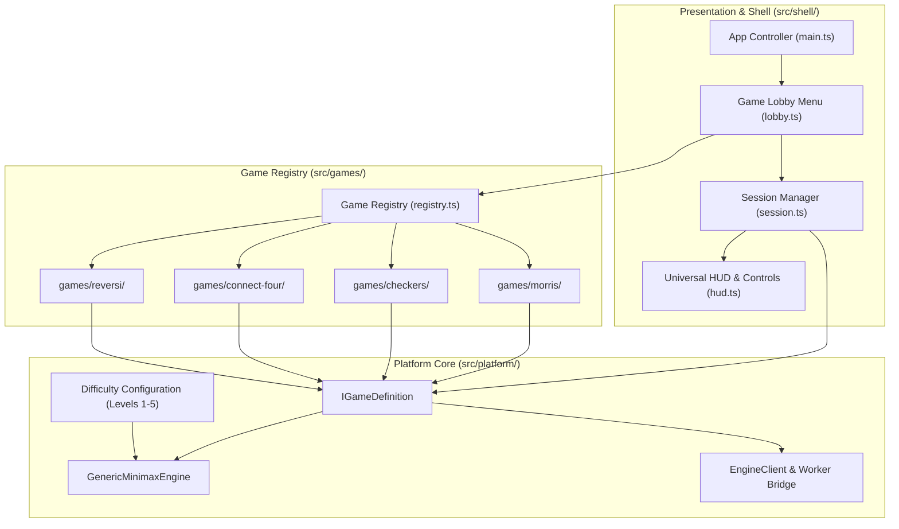
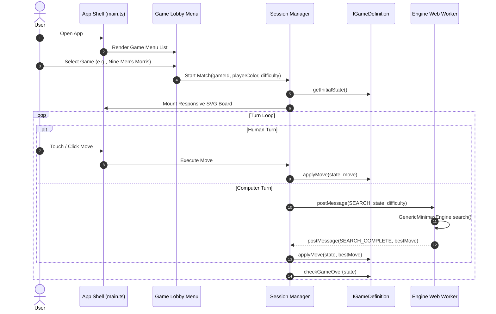

# System Design Document: Classic Board Games Platform

## 1. System Overview & Problem Statement

The **Classic Board Games Platform** is an offline-first, deterministic, responsive web and mobile application supporting classic 2-player turn-based strategy board games:
- Nine Men's Morris (*Mühlespiel*)
- English Checkers (*Draughts*)
- Connect Four
- Reversi (*Othello*)

All games share common attributes:
1. Two-player zero-sum games with alternating turns.
2. Complete information (no hidden cards or fog of war).
3. Deterministic rules without stochastic dice rolls (replayability is driven by candidate pooling and varied opening heuristics).

---

## 2. Core Architecture & Layered Boundaries



---

## 3. Component Specifications

### 3.1 Platform Core (`src/platform/`)
* **`IGameDefinition<TState, TMove>`:**
  ```typescript
  export interface IGameDefinition<TState, TMove> {
    readonly id: string;
    readonly name: string;
    readonly description: string;
    getInitialState(): TState;
    getCurrentPlayer(state: TState): Player;
    getLegalMoves(state: TState): TMove[];
    applyMove(state: TState, move: TMove): TState;
    evaluateState(state: TState, perspectivePlayer: Player): number;
    serializeState(state: TState): string;
    checkGameOver(state: TState): GameOverResult;
    orderMoves?(moves: TMove[], state: TState, deterministic?: boolean): TMove[];
    isTacticalMove?(move: TMove, state: TState): boolean;
  }
  ```
* **`GenericMinimaxEngine<TState, TMove>`:**
  Universal search engine implementing:
  - Iterative Deepening within dynamic time budgets.
  - Negamax with Alpha-Beta pruning ($O(b^{d/2})$ complexity).
  - Transposition caching with depth verification.
  - Difficulty-scaled $\epsilon$-candidate pooling and Boltzmann/uniform sampling (eliminating deterministic repetition).
  - Immediate tactical capture prioritization.

### 3.2 Shell & Lifecycle (`src/shell/`)
* **Startup Game Lobby (`lobby.ts`):**
  Renders the initial menu list of available games. Players select a game to begin a match or switch games at any time.
* **Game Session Manager (`session.ts`):**
  Manages match lifecycle:
  - Current state and move history stack for full Undo/Redo capability.
  - Alternating turn manager (Human vs On-Device Engine).
  - Move pacing delay for natural human perception of computer moves.
  - Game Over victory, defeat, and draw dialogs.

---

## 4. Startup & Execution Flow


